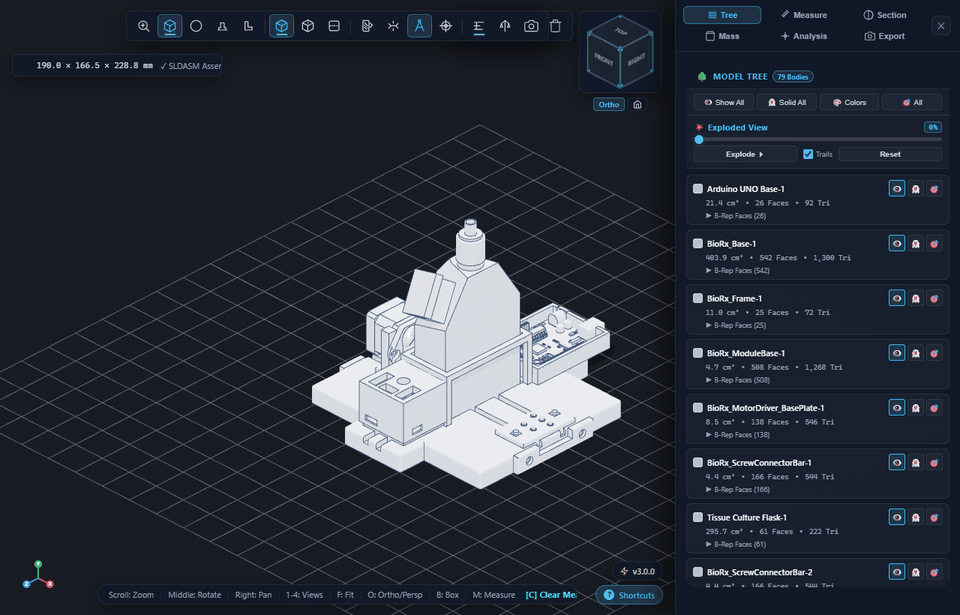
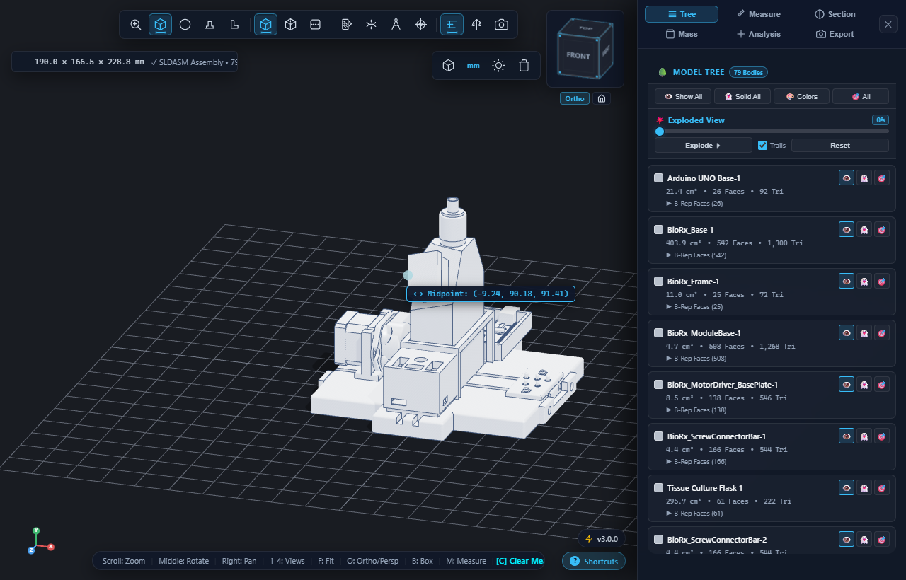
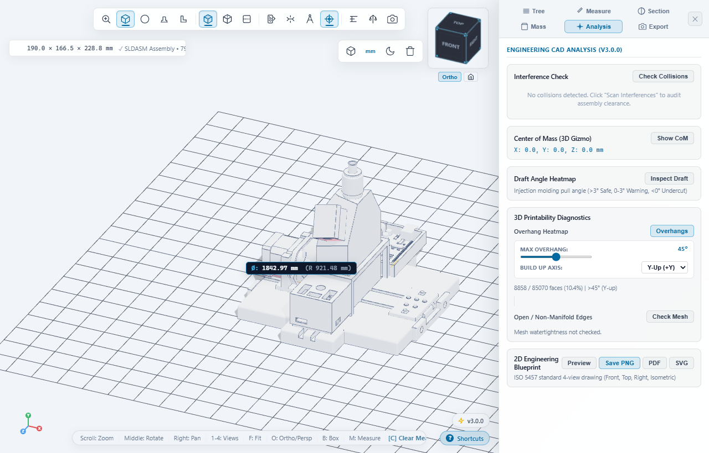
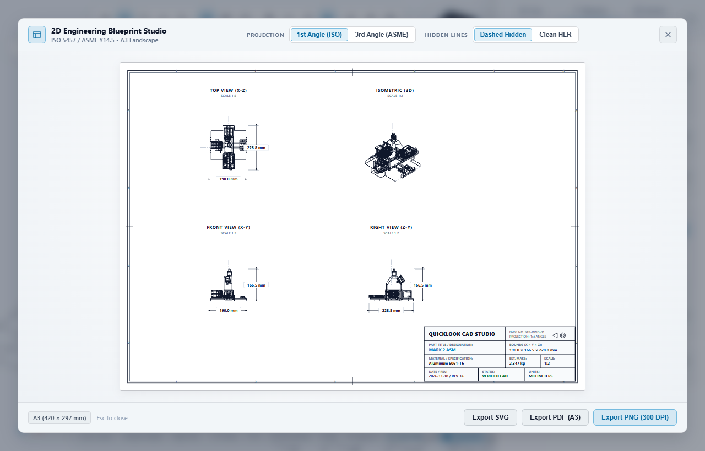

# QuickLook.Plugin.StepViewer (v3.0.0)

> **The Ultimate High-Performance 3D CAD, SolidWorks & Mesh Inspection Studio directly in Windows Explorer.**  
> Built for [QuickLook](https://github.com/QL-Win/QuickLook) — tap **Spacebar** on any `.step`, `.stp`, `.iges`, `.igs`, `.brep`, `.sldprt`, `.sldasm`, `.stl`, `.3mf`, `.obj`, `.ply`, `.glb`, or `.gltf` file for an instant, zero-lag engineering inspection experience.

[](https://github.com/Mostafa214/QuickLook.Plugin.StepViewer/releases/latest)
[](LICENSE)
[](https://github.com/QL-Win/QuickLook)
[](#-whats-new-in-version-300)
[](#-5-smart-measure-v2--3d-printability-diagnostics)
[](tests/)
[](https://dotnet.microsoft.com/)

---



---

## ⚡ What's New in Version 3.0.0

### 1. 🧩 Native SolidWorks Support (`.SLDPRT` & `.SLDASM`)
Open native SolidWorks parts and assemblies directly from Windows Explorer—no SolidWorks installation required:
* **Fast DisplayLists & Triangle-Strip Engine:** Clean-room MIT parser (`solidworksWorker.js`) decodes modern SolidWorks containers and legacy OLE2/`__ZLB` streams, unwinding `DisplayLists` (`uoTempBodyTessData_c` / `uoTempFaceTessData_c`) into full 3D meshes with preserved body and face colors.
* **Hierarchical Assembly Tree & Sibling Loading:** Parses `COMPINSTANCETREE` and `swTransform` matrices to reconstruct full `.SLDASM` hierarchies, resolving both virtual components and external sibling `.SLDPRT` files via a sandboxed same-directory endpoint.
* **Graceful `PreviewPNG` Fallback:** Parts saved without cached tessellation automatically display their embedded `PreviewPNG` thumbnail with a clear status indicator.



---

### 2. 🎨 Dual-Theme Engineering Studio, RealView & Interactive ViewCube
* **Dark CAD Studio & Light Engineering Workbench:** Switch seamlessly between a high-contrast dark studio and a crisp light engineering workbench (`localStorage`-persisted theme, units, HLR edges, and camera projection preferences).
* **RealView Studio Mode:** One-click toolbar toggle (`RealView`) elevating PMREM studio environment reflections, `ACESFilmic` exposure, PBR metallic/roughness sheen, and grounded floor shadows — carried directly into Snapshot exports.
* **Native STEP Per-Face & SolidWorks Appearance Colors:** Preserves original STEP AP214/AP242 per-face colors (`STYLED_ITEM`) and SolidWorks appearance colors on load, while allowing per-body material overrides and 1-click Reset.
* **3D ViewCube Navigation:** Clickable interactive orientation cube with hover highlights and smooth camera tweening across Isometric, Top, Front, Right, Back, Left, and Bottom views.



---

### 3. 🎯 BVH Exact Mesh Collision & True Volumetric Center of Mass
* **Exact Triangle-Triangle Collision (`three-mesh-bvh`):** Upgrades assembly interference checks from bounding-box approximations to AABB broad-phase + `MeshBVH` narrow-phase exact triangle intersection.
* **True Volumetric Center of Mass:** Computes exact signed-tetrahedron centroid summation ($\vec{C} = \frac{\sum V_i \cdot (\vec{a}_i + \vec{b}_i + \vec{c}_i)/4}{\sum V_i}$) integrated with the active material density from the Materials Engine.

---

### 4. 📐 2D Blueprint Studio (BVH-Accelerated HLR & Live Preview Modal)
Generate ISO 5457 / ISO 7200 multi-view technical drawings with real-time interactive review:
* **BVH-Accelerated Hidden Line Removal (HLR):** Casts BVH-accelerated occlusion rays so hidden edges render cleanly as dashed lines (`#94a3b8`) behind solid geometry.
* **Interactive Live Preview Modal:** Toggle **First-Angle vs. Third-Angle Projection**, **Show/Hide Hidden Lines**, and **Metric (mm) / Imperial (in)** before exporting.
* **Triple-Format Export:** Export to **300 DPI PNG**, **ISO A3 PDF (1.4)**, or **Scalable Vector Graphics (SVG)**.



---

### 5. 📏 Smart Measure v2 & 3D Printability Diagnostics
* **Multi-Dimension Pinning:** Pin multiple distance, hole diameter ($\varnothing$), and center-to-center pitch annotations simultaneously in the 3D viewport with individual delete/clear controls.
* **Wall Thickness Probe:** Casts a BVH ray inward along the opposite face normal to measure local wall thickness directly on the part.
* **Minimum Clearance Distance:** Computes exact minimum clearance distance between any two selected bodies in an assembly.
* **3D Printability Diagnostics:**
  * **Overhang Angle Heatmap:** Configurable support threshold slider (`15°–75°`) highlighting downward-facing overhangs with red/amber color coding.
  * **Open & Non-Manifold Edge Visualizer:** Highlights boundary edges (`count === 1`) in magenta and non-manifold edges (`count > 2`) in red directly on the mesh.
* **Infill & Filament Slicer Estimator:** Real-time infill percentage slider (`15%–100%`), PLA/PETG/ABS/TPU/Resin presets, 1.75 mm filament length, and 1 kg spool consumption.

---

### 6. 🌐 Multi-Format Support & Format Conversion Export
* **Expanded Native Format Support:** Added **`.3mf`**, **`.obj`** (+ `.mtl`), **`.ply`** (ASCII & binary), and **`.glb` / `.gltf`** alongside **`.step`**, **`.stp`**, **`.iges`**, **`.igs`**, **`.brep`**, **`.stl`**, **`.sldprt`**, and **`.sldasm`**.
* **Zero-WASM Worker Pipeline:** Dedicated Web Workers (`stlWorker.js` & `solidworksWorker.js`) keep large STL and SolidWorks parsing off the UI thread via Zero-Copy `Transferable` buffers.
* **Format Conversion Export:** Convert and export any loaded CAD or mesh model directly to **Binary `.STL`**, **`.OBJ`**, or **`.GLB`** from the Export tab.

---

### 7. ✂️ SolidWorks-Grade Section View & Exploded Assembly
* **Dynamic Stencil Section View (`S`):** Interactive X/Y/Z cutting planes with watertight stencil capping, 3D manipulator gizmo, and precision numeric offset input.
* **Exploded Assembly View (`X`):** Smooth radial displacement for multi-body STEP and SolidWorks assemblies with animated trajectory guide trails.

---

## 📊 Feature Comparison

| Feature | **QuickLook StepViewer v3.0.0** | Legacy Viewers | Basic Web/OS Viewers |
|---|:---:|:---:|:---:|
| **Supported Formats** | **STEP, IGES, BREP, SLDPRT, SLDASM, STL, 3MF, OBJ, PLY, GLB/GLTF** | STL only | 1–2 formats |
| **Native SolidWorks Preview** | **✅ DisplayLists + Assembly Tree + PreviewPNG** | ❌ None | ❌ None |
| **Collision & Center of Mass** | **✅ BVH Exact Mesh & True Tetrahedron CoM** | ❌ None | ❌ Bounding box only |
| **Smart Measure v2** | **✅ Multi-Pin, Holes ($\varnothing$), Wall Thickness, Min Clearance** | ❌ None | ❌ Vertices only |
| **3D Printability Diagnostics** | **✅ Overhang Heatmap, Open/Non-Manifold Edges, Infill** | ❌ None | ❌ None |
| **2D Blueprint Studio** | **✅ BVH HLR, 1st/3rd Angle, Live Preview, PDF/PNG/SVG** | ❌ None | ❌ None |
| **Format Conversion Export** | **✅ Export to Binary STL, OBJ, GLB** | ❌ None | ❌ None |
| **Dual-Theme Studio** | **✅ Dark CAD Studio & Light Engineering Workbench** | ❌ Fixed | ❌ Fixed |
| **In-App Auto-Updater** | **✅ 1-Click Atomic Restart** | ❌ None | ❌ None |
| **Automated Verification** | **431 Automated Tests (C# + Node.js)** | 0 tests | Untested |

---

## ⌨️ Keyboard Shortcuts & Controls

| Shortcut | Action | Description |
| :---: | :--- | :--- |
| **`Spacebar`** | **Preview / Close** | Instant QuickLook preview toggle |
| **`M`** | **Smart Measure v2** | Multi-pin hole centers, edge midpoints, wall thickness & clearance |
| **`B`** | **Bounding Box** | Toggle 3D AABB bounding box & dimensions overlay |
| **`A`** | **Engineering Analysis** | Open Analysis tab (Printability, CoM, BVH Collision, 2D Blueprint Studio) |
| **`S`** | **3D Section View** | Interactive cutting plane with 3D gizmo, numeric offset & watertight cap |
| **`X`** | **Exploded View** | Smooth radial displacement for multi-body STEP & SolidWorks assemblies |
| **`T`** | **Model Tree** | Assembly hierarchy, solid bodies, isolate (`I`), and ghost X-ray (`G`) |
| **`P`** | **Physical Properties** | Volume, surface area, material density, and 3D print metrics |
| **`K`** | **Snapshot / Export** | Capture high-DPI PNG snapshot or export to STL / OBJ / GLB |
| **`O`** | **Ortho / Perspective** | Toggle between Orthographic and Perspective camera projection |
| **`U`** | **Unit Switcher** | Toggle Metric ($\text{mm}$) $\longleftrightarrow$ Imperial ($\text{inches}$) |
| **`C` / Right-Click**| **Quick Clear** | Clear active dimensions or reset tool without closing preview |
| **`E`** | **Toggle Edges (HLR)** | Show/hide SolidWorks-style mechanical crease outlines |
| **`F`** | **Auto-Fit Camera** | Re-center and fit model into the viewport |
| **`W`** | **Wireframe Mode** | Toggle wireframe rendering |
| **`R`** | **Reset View** | Return camera to default isometric perspective |
| **`1` – `4`** | **Standard Views** | Isometric (`1`), Top (`2`), Front (`3`), and Right (`4`) standard views |
| **`?`** | **Keyboard Shortcuts** | Open/close the interactive keyboard shortcuts overlay |

---

## 📥 Installation

> [!TIP]
> **No compilation or programming knowledge required!** Download the `.qlplugin` file and QuickLook handles the rest.

### Method 1: The QuickLook Way (Recommended)
1. **[Download QuickLook.Plugin.StepViewer.qlplugin](https://github.com/Mostafa214/QuickLook.Plugin.StepViewer/releases/latest/download/QuickLook.Plugin.StepViewer.qlplugin)**
2. Navigate to your **Downloads** folder in Windows Explorer.
3. Select `QuickLook.Plugin.StepViewer.qlplugin` and press **Spacebar**.
4. Click **Install** when prompted by QuickLook.
5. Restart QuickLook (right-click the tray icon $\rightarrow$ **Restart**).
6. Highlight any `.step`, `.stp`, `.iges`, `.igs`, `.brep`, `.sldprt`, `.sldasm`, `.stl`, `.3mf`, `.obj`, `.ply`, `.glb`, or `.gltf` file and press **Spacebar**!

### Method 2: In-App 1-Click Auto-Updater (For Existing Users)
When a new version is released:
1. An update notification button `[ Update to v3.X.X ]` will automatically appear in the top bar.
2. Click `[ ⓘ ]` to view single-line release highlights.
3. Click the update button to download and apply with an atomic 1-click QuickLook restart.

### Method 3: Manual Deployment
1. Download `QuickLook.Plugin.StepViewer.qlplugin` and rename `.qlplugin` to `.zip`.
2. Extract the archive into your QuickLook plugin directory:
   * **Installer / Portable:** `%APPDATA%\pooi.moe\QuickLook\QuickLook.Plugin\QuickLook.Plugin.StepViewer\`
   * **Microsoft Store:** `%LOCALAPPDATA%\Packages\21090PaddyXu.QuickLook_egxr34yet59cg\LocalCache\Roaming\pooi.moe\QuickLook\QuickLook.Plugin\QuickLook.Plugin.StepViewer\`
3. Restart QuickLook.

---

## 🏗️ Architecture & Multi-Pipeline Isolation

```
                         Windows Explorer (Spacebar)
                                     │
                                     ▼
                           QuickLook Host Process
                                     │
                                     ▼
              QuickLook.Plugin.StepViewer (C# .NET 4.8 / WPF)
              ├── StepMetadataParser (Fast Header Validation + OpenMcdf OLE2)
              ├── WebViewEnvironmentManager (Virtual Host + Sandboxed Sibling Endpoint)
              └── SnapshotExportService (PNG / PDF / SVG / STL / OBJ / GLB)
                                     │
         ┌───────────────────────────┼───────────────────────────┐
         │ WebView2 (Chromium Embedded)                          │
         │                           │                           │
  [*.stl / 3MF / OBJ / PLY / GLB]  [*.sldprt / *.sldasm]  [*.step / *.iges / *.brep]
         │                           │                           │
         ▼                           ▼                           ▼
┌─────────────────────┐  ┌─────────────────────────┐  ┌─────────────────────────┐
│ stlWorker.js &      │  │ solidworksWorker.js     │  │ stepWorker.js           │
│ Three.js Loaders    │  │  ├── DisplayLists       │  │  ├── OpenCASCADE.js     │
│  ├── Zero-Copy      │  │  ├── COMPINSTANCETREE   │  │  ├── B-Rep Topology     │
│  └── Gauss Volume   │  │  └── PreviewPNG Fallback│  │  └── Tangent HLR Edges  │
└────────┬────────────┘  └────────────┬────────────┘  └────────────┬────────────┘
         │                            │                            │
         └────────────────────────────┼────────────────────────────┘
                                      │
                                      ▼
 ┌─────────────────────────────────────────────────────────────────────────────────┐
 │ Three.js r128 Dual-Theme CAD Studio Runtime                                     │
 │  ├── meshFeatureDetector.js (Kåsa Circle Fit & >25° Crease Midpoints)           │
 │  ├── measureEngine.js (Multi-Pin, Wall Thickness & Min Clearance via BVH)       │
 │  ├── cadAnalysisEngine.js (BVH Collision, Tetrahedron CoM, Overhang/Manifold)   │
 │  ├── blueprintSvgEngine.js (BVH HLR, 1st/3rd-Angle, Live Preview Modal, PDF/SVG)│
 │  ├── materialsEngine.js (3D Print Infill & 1.75mm Filament Estimator)           │
 │  ├── sectionEngine.js (Watertight Stencil Dynamic Capping, Gizmo & Offset)      │
 │  └── assemblyTree.js & explodedView.js (Multi-Body Isolation & Radial Trails)   │
 └─────────────────────────────────────────────────────────────────────────────────┘
```

---

## 🛡️ Enterprise Security & Verification Standards

* **Zero External Telemetry:** 100% offline, local-first execution. Your proprietary CAD designs, SolidWorks assemblies, and 3D models never touch external networks or cloud servers.
* **Strict Content Security Policy (CSP) & Same-Directory Sandboxing:** Full sandbox enforcement blocking script injection and untrusted cross-origin requests; sibling `.SLDASM` part resolution is strictly confined to the active assembly's parent directory.
* **431 Automated Regression Tests:** Comprehensive C# xUnit (`QuickLook.Plugin.StepViewer.Tests.csproj`) and Node.js engine test suites covering IPC security, header validation, BVH collision/CoM, HLR blueprint projection, multi-format loaders/exporters, Smart Measure v2, printability diagnostics, and SolidWorks container parsing.

---

## 📄 License & Attribution

This project is open-source under the [MIT License](LICENSE).

Crafted with dedication for mechanical engineers, designers, and 3D printing makers worldwide by **[Mostafa Azimi](https://github.com/Mostafa214)**.
