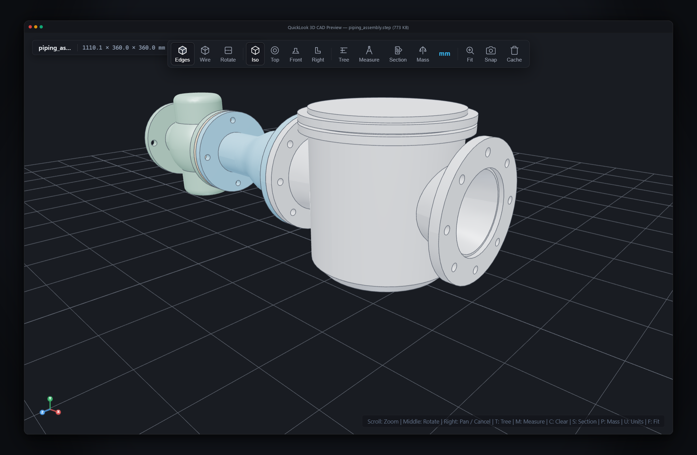
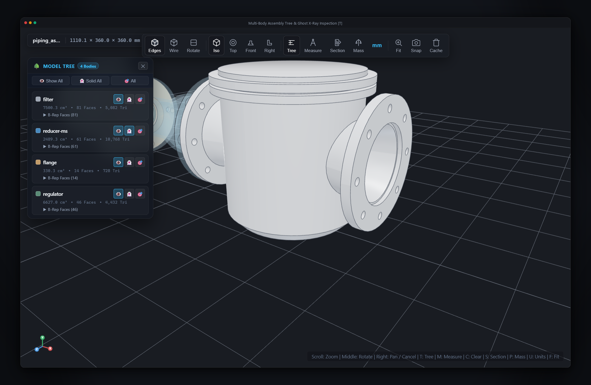
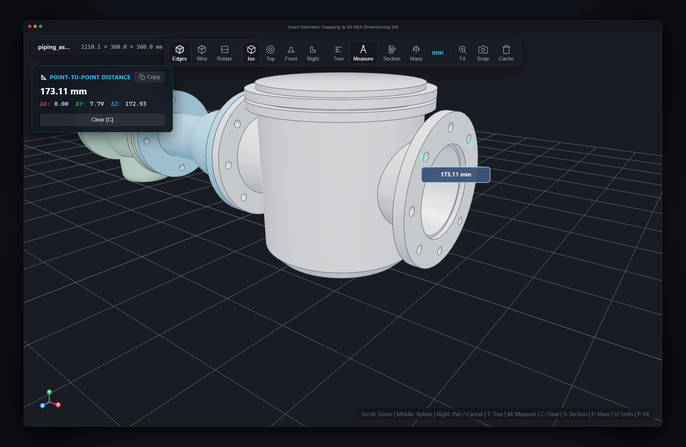
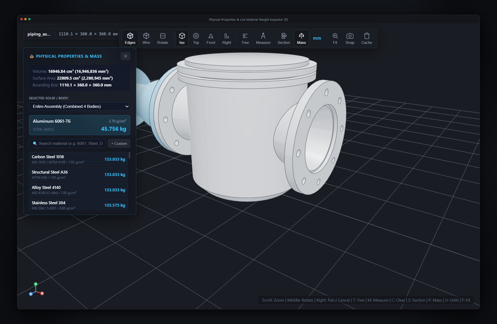

# QuickLook.Plugin.StepViewer

> **Instant, Zero-Lag 3D CAD Preview for STEP, IGES & BREP Files directly in Windows Explorer.**  
> Built for [QuickLook](https://github.com/QL-Win/QuickLook) — just highlight any `.step`, `.stp`, `.iges`, `.igs`, or `.brep` file and tap **Spacebar**.

[](LICENSE)
[](https://github.com/QL-Win/QuickLook)
[](#-multi-cad-format-support)
[](https://dotnet.microsoft.com/)
[-orange?style=flat-square)](https://github.com/donalffons/opencascade.js)
[](https://threejs.org/)
[](#-1-click-in-app-auto-updater)

---


---

## Features at a Glance

* **Spacebar Instant CAD Inspection:** Zero wait time, zero software bloat. Tap Spacebar on any STEP, IGES, or BREP file in Windows Explorer for a silky-smooth, 60 FPS 3D CAD inspection window.
* **1-Click In-App Auto-Updater:** Zero-hassle background update notification. Automatically checks GitHub Releases, displays a sleek morphing button in the top navbar with real-time download progress, a single-line release highlights drawer `[ ⓘ ]`, and executes an atomic 1-click QuickLook restart.
* **Dual-Tier Performance Acceleration:** WebAssembly bytecode caching via IndexedDB (`WebAssembly.compile`) drastically reduces subsequent load times, paired with two-way zero-copy `ArrayBuffer` transfer lists between UI thread and Web Worker.
* **Multi-CAD Format Support:** Native parsing and rendering for STEP (`.step`, `.stp`), IGES (`.iges`, `.igs`), and OpenCASCADE Boundary Representation (`.brep`).
* **SolidWorks-Grade Section View (`S` key):** Dynamic cutting plane on X, Y, or Z axes with watertight stencil capping (dark slate contrast fill) and an interactive 3D arrow manipulator gizmo (drag directly in 3D viewport space).
* **Interactive Exploded Assembly View (`X` key):** Smooth radial displacement for multi-body assemblies with animated slider and 3D dashed trajectory guide trails.
* **Smart CAD Measure Tool (`M` key):**
  * **Intelligent Geometric Snapping:** Instantly snaps to vertices, edge midpoints, and circular hole centers.
  * **Direct Feature Dimensions:** Read linear edge lengths, circular hole diameters ($\varnothing$) / radii ($R$), and planar face surface areas.
  * **3D Delta Distance:** Click any two points, edges, or hole centers to inspect Euclidean 3D distance and Cartesian $(\Delta X, \Delta Y, \Delta Z)$ components with automatic leader dimension lines.
  * **Ergonomic Quick Clear:** Fast cancellation via **`C`** key or **Right-Click** without triggering QuickLook window close.
  * **Dual Units:** Live one-touch toggle between Metric ($\text{mm}, \text{mm}^2, \text{cm}^3$) and Imperial ($\text{in}, \text{in}^2, \text{in}^3$) via the `U` key.
* **Model Tree & Multi-Body Assembly Panel (`T` key):**
  * Explore individual solid bodies and underlying B-Rep topological faces.
  * **Interactive 3D Hover & Focus:** Hover over any body in the tree to light it up in the viewport; click to smoothly animate camera zoom and focus on it.
  * **Isolate Mode (`I`):** Solo inspection of complex internal parts in multi-body models.
  * **Ghost / X-Ray Mode (`G`):** Semi-transparent silhouette mode to see inside assemblies without hiding geometry.
  * **Body Visibility (`V`):** Toggle individual solid bodies on and off.
* **SolidWorks-Grade HLR Edge Rendering:** Clean, crisp mechanical crease outlines matching professional engineering CAD software, with tangent blend suppression and parametric seam elimination.
* **Mass Properties & Material Calculator (`P` key):**
  * Calculates real CAD volume and surface area.
  * Live weight calculation with built-in material density presets: *Structural Steel*, *6061 Aluminum*, *Brass*, *Grade 5 Titanium*, *ABS Plastic*, *Delrin (POM)*, and *Acrylic*.
* **Custom Color & Engineering Materials:** Apply realistic PBR materials (Steel, Aluminum, Brass, Titanium, Plastics) and custom surface colors to individual solid bodies.
* **High-DPI 4K CAD Export:** Studio lighting, contact shadows, ambient occlusion, transparent/studio backgrounds, and QR Code title blocks for instant engineering handoff.

---

## Visual Showcase

### Instant Spacebar 3D Inspection
Full-fidelity 60 FPS 3D viewport with SolidWorks-grade HLR mechanical crease lines, multi-body material shading, and Studio Graphite HUD.


### Multi-Body Assembly Tree & Ghost X-Ray (`T`)
Inspect complex assemblies with individual solid body hierarchies, real-time volume / face metrics, and Ghost X-Ray mode to see internal mating components.


### Smart CAD Snapping & Precision 3D Dimensions (`M`)
Snaps dynamically to 3D vertices, circular hole centers, and linear edges with Cartesian $(\Delta X, \Delta Y, \Delta Z)$ delta readouts and ergonomic `C` quick-clear.


### Physical Properties & Material Weight Calculator (`P`)
Calculates real CAD volume, surface area, and live weight estimation across industry metals and engineering plastics (*Structural Steel*, *6061 Aluminum*, *Brass*, *Titanium*, *ABS*).


---

## Installation

> [!TIP]
> **No compilation or coding required!** If you are a mechanical engineer or CAD designer, simply download the ready-to-use `.qlplugin` file below and let QuickLook handle the installation in 3 seconds.

### Method 1: The One-Click QuickLook Way (Recommended)
1. **[Download Latest `QuickLook.Plugin.StepViewer.qlplugin`](https://github.com/Mostafa214/QuickLook.Plugin.StepViewer/releases/latest/download/QuickLook.Plugin.StepViewer.qlplugin)** *(Always links directly to the latest release binary).*  
   *(Or browse all versions on the [Releases](https://github.com/Mostafa214/QuickLook.Plugin.StepViewer/releases) page).*
2. Open your **Downloads** folder in Windows Explorer.
3. Select `QuickLook.Plugin.StepViewer.qlplugin` and press **Spacebar**.
4. QuickLook will pop up asking to install the plugin. Click **Install**.
5. Restart QuickLook (right-click the QuickLook icon in the system tray and select **Restart**).
6. Done! Select any `.step`, `.stp`, `.iges`, `.igs`, or `.brep` file and tap **Spacebar** to inspect in 3D.

### Method 2: In-App Auto-Updater (For Existing Users)
Once installed, future updates are detected automatically. When a new version is released:
1. An update button appears in the top navigation bar: `[ Update to v1.X.X ]`.
2. Click `[ ⓘ ]` to view single-line release highlights.
3. Click the update button to download; watch the in-place progress bar.
4. When finished, click `[ ↻ Restart QuickLook ]` to complete the update automatically.

### Method 3: Manual Installation
1. Download `QuickLook.Plugin.StepViewer.qlplugin` and rename the extension from `.qlplugin` to `.zip`.
2. Extract the folder into your QuickLook plugin directory:
   * **Installer / Portable version:**  
     `%APPDATA%\pooi.moe\QuickLook\QuickLook.Plugin\QuickLook.Plugin.StepViewer\`
   * **Microsoft Store version:**  
     `%LOCALAPPDATA%\Packages\21090PaddyXu.QuickLook_egxr34yet59cg\LocalCache\Roaming\pooi.moe\QuickLook\QuickLook.Plugin\QuickLook.Plugin.StepViewer\`
3. Restart QuickLook.

---

## Keyboard Shortcuts & Controls

| Shortcut / Input | Action |
| :--- | :--- |
| **Spacebar** | Open / Close QuickLook CAD preview window |
| **Left Click + Drag** | Orbit / Rotate model 3D camera |
| **Right Click + Drag** | Pan 3D camera |
| **Mouse Scroll Wheel** | Zoom In / Out |
| **`C`** or **Right-Click** | **Clear active measurement**, cancel tool, or deselect active body/face |
| **`M`** | Toggle Smart Measure Tool |
| **`T`** | Toggle Model Tree / Multi-Body Assembly Panel |
| **`X`** | Toggle Interactive Exploded Assembly View |
| **`S`** | Toggle 3D Section View & Manipulator Gizmo |
| **`P`** | Toggle Mass Properties & Material Weight Inspector |
| **`U`** | Switch Units between Metric (mm) and Imperial (inches) |
| **`I`** | Isolate currently active body (in Tree Panel) |
| **`G`** | Toggle Ghost / X-Ray transparency on active body |
| **`V`** | Toggle active body visibility |
| **`F`** | Auto-Fit camera to model bounding box |
| **`E`** | Toggle mechanical edge line display (HLR) |
| **`W`** | Toggle wireframe mode |
| **`R`** | Reset camera to default isometric perspective |
| **`K`** | Toggle snapping mode |

---

## Release Highlights Protocol (For Maintainers)

The in-app updater extracts a concise summary to display in the `[ ⓘ ]` info drawer. When publishing future GitHub Releases, include a single highlight line using any of the following formats:

```markdown
Highlights: Faster WASM loading, multi-CAD support (STEP, IGES, BREP), 3D section tools & 1-click auto-updater
```
or
```markdown
<!-- highlights: Faster WASM loading, multi-CAD support (STEP, IGES, BREP), 3D section tools & 1-click auto-updater -->
```

The parser detects this line and cleanly surfaces it inside the CAD viewer without cluttering the UI.

---

## Building from Source (For Developers Only)

### Prerequisites
* Windows 10 / 11
* [.NET Framework 4.8 Developer Pack](https://dotnet.microsoft.com/download/dotnet-framework/net48)
* [PowerShell 5.1+](https://learn.microsoft.com/powershell/)
* [QuickLook](https://github.com/QL-Win/QuickLook) installed

### Build & Package
Clone the repository and run the packaging automation script:

```powershell
git clone https://github.com/Mostafa214/QuickLook.Plugin.StepViewer.git
cd QuickLook.Plugin.StepViewer

# Clean compile, package .qlplugin, install to local QuickLook, and restart:
powershell -ExecutionPolicy Bypass -File .\pack-plugin.ps1 -Install -RestartQuickLook
```

The compiled package will be generated at `./QuickLook.Plugin.StepViewer.qlplugin`.

---

## Architecture & Technology Stack

```
Windows Explorer (Spacebar)
       │
       ▼
QuickLook Host Process
       │
       ▼
QuickLook.Plugin.StepViewer (C# .NET 4.8 / WPF)
       │
       ▼ Microsoft Edge WebView2 (Chromium Embedded)
┌────────────────────────────────────────────────────────┐
│ viewer.html + Three.js r128                            │
│  ├── 60 FPS OrbitControls & Studio Graphite Viewport   │
│  ├── Interactive Smart Measure Raycaster Engine        │
│  ├── 3D Section View with Watertight Stencil Capping   │
│  ├── Interactive 3D Manipulator Arrow Gizmo            │
│  ├── Radial Exploded Assembly & Guide Trails Engine    │
│  ├── 1-Click Morphing Auto-Updater & Highlights Drawer │
│  └── Multi-Body B-Rep Tree Hierarchy                   │
└──────────────────────────┬─────────────────────────────┘
                           │ Web Worker Message Channel (Zero-Copy)
                           ▼
┌────────────────────────────────────────────────────────┐
│ stepWorker.js (Dedicated Background Worker)            │
│  ├── OpenCASCADE.js (WebAssembly CAD Kernel)           │
│  ├── IndexedDB WebAssembly Bytecode Cache              │
│  ├── Multi-Format CAD Loader (STEP / IGES / BREP)      │
│  ├── Multi-Body B-Rep Topology Extractor               │
│  ├── SolidWorks HLR Tangent & Silhouette Filter        │
│  └── IndexedDB Geometry Caching System                 │
└────────────────────────────────────────────────────────┘
```

---

## License

This project is licensed under the [MIT License](LICENSE) — see the [LICENSE](LICENSE) file for details.

Developed with care for the 3D CAD & engineering community by **[Mostafa Azimi](https://github.com/Mostafa214)**.
