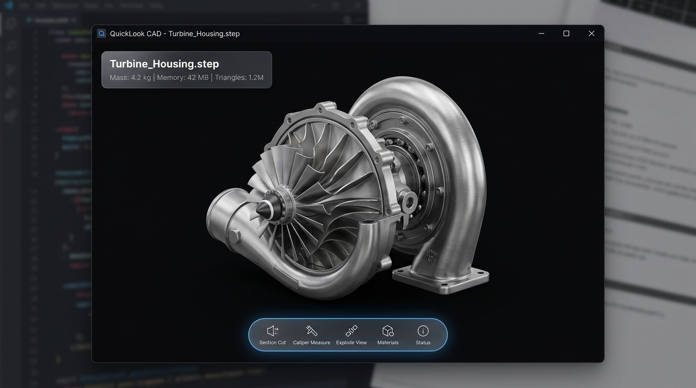
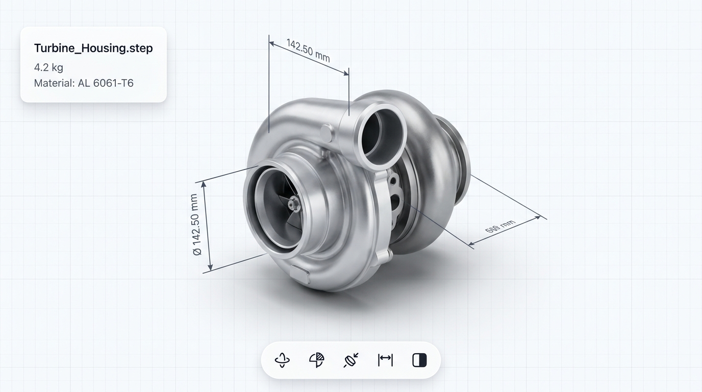
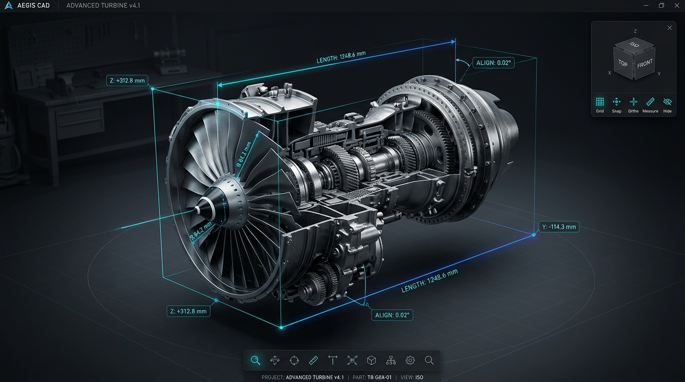
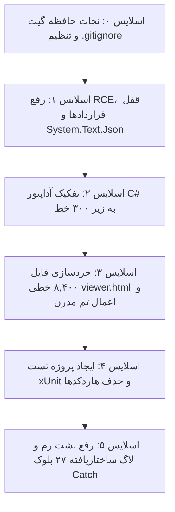

# برنامه جامع تحول معماری، امنیت صنعتی و بازطراحی مدرن UI (Master Refactor Plan)

**پروژه:** [QuickLook.Plugin.StepViewer](QuickLook.Plugin.StepViewer.csproj)  
**نسخه هدف:** v2.0.0 (Unified Engineering Workbench)  
**سند راهبردی:** منطبق بر ۱۰ ستون قوانین Industrial AI Dev Engine و استاندارد Design Engineering  
**تاریخ ثبت در پروژه:** اکتبر ۲۰۲۶

---

## ۱. کانسپت‌های بصری بازطراحی رابط کاربری (UI Visual Concepts)

سه کانسپت بصری اختصاصی با رزولوشن بالا برای این افزونه تولید شده و در مسیر `docs/images/` ذخیره شده‌اند:

### کانسپت ۱: دارک مدرن مهندسی (Linear / Raycast Dark Aesthetic)

- **پالت رنگی:** پس‌زمینه زینک فوق‌تیره (`#09090b`) با ایجاد بالاترین کنتراست ممکن برای سطوح فلزی و متریال‌های CAD.
- **داک شناور شیشه‌ای:** در پایین صفحه با حاشیه مویی ۱ پیکسلی (`border-white/10`) و نور لبه داخلی.
- **کارت‌های اطلاعاتی HUD معلق:** نمایش ابعاد قطعه، متریال، تعداد مثلث‌ها، وضعیت اشغال حافظه رم.
- **آیکون‌های وکتور:** استاندارد Lucide (حذف کامل ایموجی‌ها).

---

### کانسپت ۲: صنعتی روشن و مینیمال (Stripe / Apple Light)

- **پالت رنگی:** بوم خاکستری/سفید مات و بسیار نرم مهندسی (`#f8fafc`) با شبکه گرید متالیک ظریف.
- **طراحی سطوح:** سایه‌های ملایم چندلایه‌ای و کارت‌های تفکیک‌شده کنترل.
- **کاربرد:** ایده‌آل برای فضاهای اداری روشن و پرینت گزارش‌های مهندسی.

---

### کانسپت ۳: فوق‌فشرده و مهندسی هوافضا (Shapr3D / Fusion HUD)

- **فضای دید حداکثری:** تخصیص ۹۵٪ فضای دید به خود قطعه سه‌بعدی با حذف کامل هرگونه حاشیه زائد.
- **کنترل‌های هوشمند:** منوی خوشه‌ای میکرو در گوشه و المان‌های ابعادی مستقیم متصل به رئوس قطعه (Callout Badges).

---

## ۲. خلاصه ممیزی قضایی پروژه (Forensic Audit Summary)

ممیزی ۱۰ ستونی Industrial AI Dev Engine مشکلات زیر را در سورس‌کد پروژه کشف و ثبت نموده است:

1. **رخنه امنیتی زنجیره‌ای (XSS to Host RCE):**
   - در `StepViewerControl.xaml.cs` متد `EscapeJsonString` کوتیشن تکی (`'`) را اسکیپ نمی‌کرد.
   - نام فایل‌های دستکاری‌شده می‌توانستند از طریق `ExecuteScriptAsync` اسکریپت دلخواه را در وب‌ویو اجرا کنند.
   - مهاجم می‌توانست پیام `PERFORM_AUTO_UPDATE` ارسال کرده و دانلود باینری نامعتبر و اجرای پنهان پاورشل با `-ExecutionPolicy Bypass` را رقم بزند.
2. **شکست سقف‌های مدولار:**
   - فایل `Assets/viewer.html` دارای **۸,۴۶۱ خط** (۱۷ برابر سقف استاندارد ۵۰۰ خط).
   - کلاس `StepViewerControl.xaml.cs` دارای **۹۲۴ خط** (۲.۶ برابر سقف ۳۵۰ خط آداپتورها).
   - فایل `Assets/stepWorker.js` دارای **۷۶۹ خط**.
3. **نقض اصل خرید بر ساخت (Buy Over Build):**
   - پارس دستی JSON با Regex و جستجوی رشته‌ای در C# به جای استفاده از `System.Text.Json`.
4. **نقض برابری تست و پروداکشن (Dev-Prod Parity):**
   - ۳۳ اسکریپت تست حاوی مسیرهای هاردکد کاربر محلی (`C:\Users\Lenovo\...`).
   - نبود پروژه تست استاندارد xUnit جهت اعتبارسنجی با `dotnet test`.
5. **خطاخواری و نشت منابع:**
   - ۲۷ بلوک خالی `catch { }` بدون لاگ در C# و JavaScript.
   - نشت حلقه `requestAnimationFrame` در زمان Dispose و عدم توقف `DispatcherTimer` در `Plugin.cs`.
6. **اسناد ناموجود (Phantom Tests):**
   - ثبت تست‌های فانتوم در `PROJECT_STATUS.md` که روی دیسک وجود نداشتند.

---

## ۳. نقشه راه مدولار اصلاحات در ۶ اسلایس (Micro-Slices)

### 🔹 اسلایس ۰: نجات اسناد حافظه پروژه (انجام شد)
- ویرایش `.gitignore` و حذف خطوطی که مانع ثبت اسناد `PROJECT_SPEC.md`، `PROJECT_STATUS.md`، `GLOSSARY.md` و `.agent/` در مخزن می‌شدند.
- انتقال تصاویر کانسپت UI به `docs/images/`.

### 🔹 اسلایس ۱: مسدودسازی RCE و استقرار قراردادهای صلب (Contract Lockdown)
- **فایل‌ها:** `QuickLook.Plugin.StepViewer.csproj`, `IpcContracts.cs` (جدید), `StepViewerControl.xaml.cs`
- **اقدامات:**
  1. افزودن پکیج رسمی مایکروسافت `System.Text.Json`.
  2. تعریف DTOهای تایپ‌شده صلب برای کلیه پیام‌های ورودی و خروجی وب‌ویو.
  3. جایگزینی اینترپولیشن رشته‌ای و متدهای پارس دستی با متد امن `PostWebMessageAsJson`.
  4. اعمال اعتبارسنجی دقیق SHA-256 قبل از هرگونه استخراج بسته آپدیتر و تایید کاربر.

### 🔹 اسلایس ۲: تفکیک کلاس مونوپولی کنترلر WPF (رعایت سقف ۳۵۰ خط)
- **فایل‌ها:** `StepViewerControl.xaml.cs`, `PluginUpdateService.cs` (جدید), `WebViewEnvironmentManager.cs` (جدید)
- **اقدامات:**
  1. انتقال منطق آپدیتر به سرویس مستقل `PluginUpdateService.cs`.
  2. انتقال تنظیمات محیط WebView2 به `WebViewEnvironmentManager.cs`.
  3. رساندن حجم کنترلر به زیر ۲۸۰ خط.

### 🔹 اسلایس ۳: خردسازی مونوکلاس ۸,۴۰۰ خطی [viewer.html](Assets/viewer.html) و اعمال UI مدرن
- **فایل‌ها:** `Assets/viewer.html`, `Assets/css/viewer.css` (جدید), `Assets/js/measureEngine.js` (جدید), `Assets/js/sectionEngine.js` (جدید), `Assets/js/assemblyTree.js` (جدید), `Assets/js/adminTwin.js` (جدید)
- **اقدامات:**
  1. تفکیک استایل‌ها به سیستم دیزاین توکن‌های مدرن در `viewer.css`.
  2. ماژولارسازی موتورهای اندازه‌گیری، برش استنسیل، درخت قطعات و مانیتورینگ سلامت.
  3. رساندن حجم `viewer.html` به زیر ۴۵۰ خط کد.

### 🔹 اسلایس ۴: استانداردسازی محیط تست و برابری (Dev-Prod Parity)
- **فایل‌ها:** `QuickLook.Plugin.StepViewer.Tests.csproj` (جدید), `tests/StepMetadataParserTests.cs` (جدید), `tests/automation/*.ps1`
- **اقدامات:**
  1. ایجاد پروژه تست استاندارد بر پایه `xUnit`.
  2. تست پارسر متادیتا و قراردادهای صلب با دستور `dotnet test`.
  3. انتقال اسکریپت‌های تست ریشه به `tests/automation/` و جایگزینی مسیرهای محلی با `$PSScriptRoot`.

### 🔹 اسلایس ۵: رفع نشت حافظه و پاک‌سازی ۲۷ بلوک خالی Catch
- **فایل‌ها:** `Plugin.cs`, `Assets/viewer.html`, `StepViewerControl.xaml.cs`
- **اقدامات:**
  1. متوقف ساختن `requestAnimationFrame` در زمان بسته شدن پنجره.
  2. فراخوانی `.Stop()` روی `DispatcherTimer` در متد `Cleanup`.
  3. جایگزینی تمامی ۲۷ بلوک خالی `catch` با ثبت لاگ ساختاریافته.

---

## ۴. استراتژی راستی‌آزمایی (Verification Gates)
- **کامپایل کامل سولوشن:** `dotnet build QuickLook.Plugin.StepViewer.sln -c Release`
- **اجرای تست‌های رسمی:** `dotnet test tests/QuickLook.Plugin.StepViewer.Tests.csproj -v minimal`
- **کنترل سقف فایل‌ها:** اسکریپت پایش خطوط کد جهت تضمین سقف ۵۰۰ خطی در سورس‌ها.
